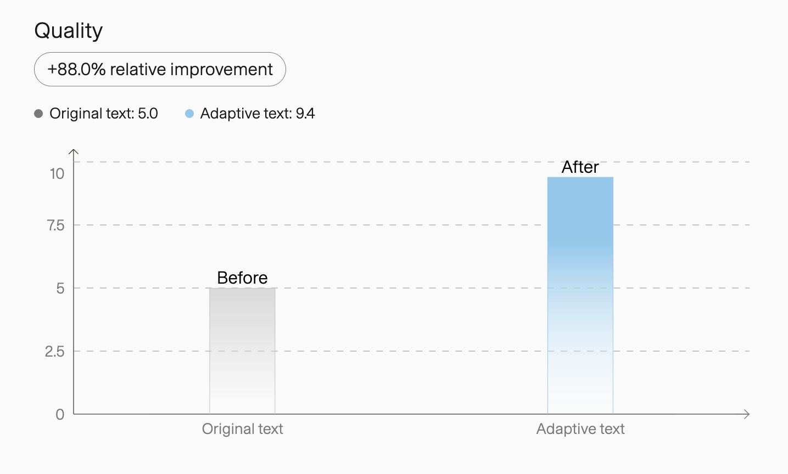
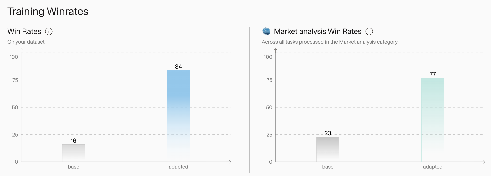
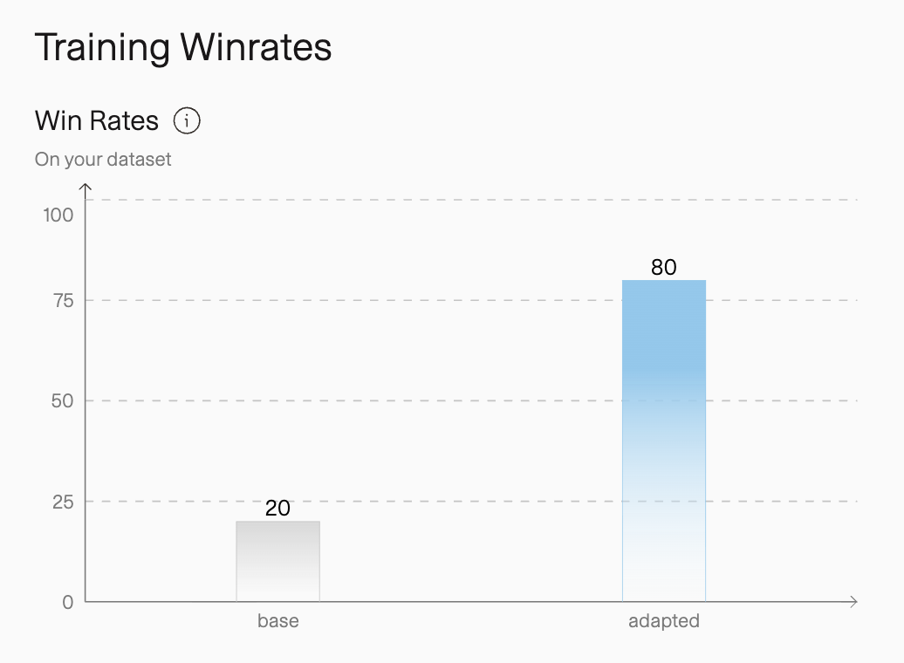

# AdaptMarket


> Evidence-grounded equity research from dated company and market briefs.

AdaptMarket is the current experiment in a three-stage AutoScientist research program with Adaption Labs. It is a full supervised fine-tune of `mistralai/Mixtral-8x7B-Instruct-v0.1` for the **Market Analysis & News — Equity Analysis** track of the AutoScientist Challenge 2026.

This public showcase combines the current AdaptMarket record with the released history documented in the [companion write-up](https://adaptions-writeup.vercel.app/). It contains documentation, public predecessor links, and figures already published by that report. AdaptMarket source documents, training data, prompts, weights, and per-example evaluation outputs remain restricted.

## Current result

| Evaluation | Base | AdaptMarket | Change |
| --- | ---: | ---: | ---: |
| On-dataset preference | 15% | **85%** | **+70 percentage points** |
| Market Analysis preference | 27% | **73%** | **+46 percentage points** |

These are platform-reported pairwise preference rates, not accuracy, investment-return, or trading-performance measures.

## Experiment timeline

| Stage | Base model | Method | Public data scale | Reported preference result | Status |
| --- | --- | --- | ---: | --- | --- |
| Attempt #1 — Proof of Concept | `meta-llama/Llama-3.3-70B-Instruct-Reference` | LoRA SFT | 27,862 adapted rows | 84–16 on-dataset; 77–23 Market Analysis | Dataset and adapter released |
| Attempt #2 — Scaling 50x | `togethercomputer/Llama-4-Scout-17B-16E-Instruct_bnb_4bit` | LoRA SFT | 45,758 combined rows | 80–20 on-dataset; no category result | Dataset and adapter released |
| Attempt #3 — AdaptMarket | `mistralai/Mixtral-8x7B-Instruct-v0.1` | Full-model SFT | Restricted | 85–15 on-dataset; 73–27 Market Analysis | Documentation released |

The experiments are not direct head-to-head comparisons. Their models, data, training methods, and evaluation scopes differ. See [Experiment history](docs/EXPERIMENT_HISTORY.md).

## Progress record

### Attempt #1 — quality and transfer

Adaptive Data expanded the 589-row training split to 27,862 rows; 27,405 rows were used for LoRA training. Platform quality moved from 5.0 to 9.4, and the adapted model recorded both a dataset-specific and broader Market Analysis preference result.





### Attempt #2 — data scaling

The source corpus expanded from roughly 1,500 to about 7,000 institutional reports. Three Adaptive Data generations over the same source corpus were combined into 45,758 rows. Quality moved from 8.0 to 9.4, and the adapted model recorded an 80-to-20 dataset-specific preference result.




### Attempt #3 — full fine-tuning

| Field | Value |
| --- | --- |
| Date | 30 July 2026 |
| Track | Market Analysis & News — Equity Analysis |
| Method | Full-model supervised fine-tuning through AutoScientist |
| Data format | Chat |
| Epochs | 1 |
| Learning rate | `0.00001` |
| LoRA | Disabled |
| Training experiment | `e7becda4-f659-4704-b2f8-67f76a029e52` |
| Fine-tune job | `5b1fe1bb-c695-4bfd-bb05-eb24335634e0` |

No cleared result image exists for Attempt #3. Its current public evidence is the experiment record and platform-reported aggregate metrics in [Results](docs/RESULTS.md).

## What AdaptMarket does

Given a dated company or market brief, the model is intended to:

- separate reported facts from guidance, forecasts, and opinion;
- connect evidence to business performance and valuation;
- surface catalysts, risks, uncertainty, and missing evidence;
- produce a concise first-pass research view rather than generic sentiment or a buy/sell instruction.

[Methods](docs/METHODS.md) · [Results](docs/RESULTS.md) · [Model card](model_card/README.md) · [Roadmap](docs/ROADMAP.md)

## Public artifact index

### Current AdaptMarket experiment

| Artifact | Status |
| --- | --- |
| Research record | This repository |
| Dataset | Restricted; not released |
| Model weights | Restricted; not released |
| Prompts and evaluation outputs | Restricted; not released |
| Interactive arena | Not released |

### Released predecessor experiments

| Stage | Dataset | Adapter |
| --- | --- | --- |
| Attempt #1 | [Hugging Face](https://huggingface.co/datasets/huyxdang/adaption-equity-analysis-small) · [Kaggle](https://www.kaggle.com/datasets/huydang03/adaption-equity-analysis-small) | [Hugging Face](https://huggingface.co/huyxdang/adaption_vietnam_equity_research_note) · [Kaggle](https://www.kaggle.com/models/huydang03/adaption-vietnam-equity-research-note/PyTorch/lora) |
| Attempt #2 | [Hugging Face](https://huggingface.co/datasets/huyxdang/adaption-market-analysis-final) · [Kaggle](https://www.kaggle.com/datasets/huydang03/adaption-market-analysis-final) | [Hugging Face](https://huggingface.co/huyxdang/adaption-market-analysis-final-model) · [Kaggle](https://www.kaggle.com/models/huydang03/adaption-market-analysis-final-model/PyTorch/lora) |

These predecessor releases are not the AdaptMarket dataset or model. Their host pages govern access and licensing.

## Repository layout

```text
.
├── assets/               # figures published by the companion write-up
├── data/                 # availability record and predecessor dataset index
├── docs/
│   ├── EXPERIMENT_HISTORY.md
│   ├── METHODS.md
│   ├── RESULTS.md
│   ├── ROADMAP.md
│   ├── REPRODUCE.md
│   └── PUBLIC_RELEASE_POLICY.md
├── model_card/           # current model card and predecessor adapter index
├── results/              # aggregate result record and figure manifest
└── README.md
```

## Data availability

No current AdaptMarket training or evaluation data is included. The underlying material and derived records remain restricted. Any future release requires provenance, licensing, redistribution, privacy, security, leakage, and reproducibility review. See [data availability](data/README.md).

## Limitations

The reported preference rates do not establish real-world financial performance, independent human validation, statistical significance, or generalization beyond the reported platform evaluations.

AdaptMarket is a research prototype. It is not financial, investment, tax, or legal advice and should not be used as the sole basis for investment decisions.
